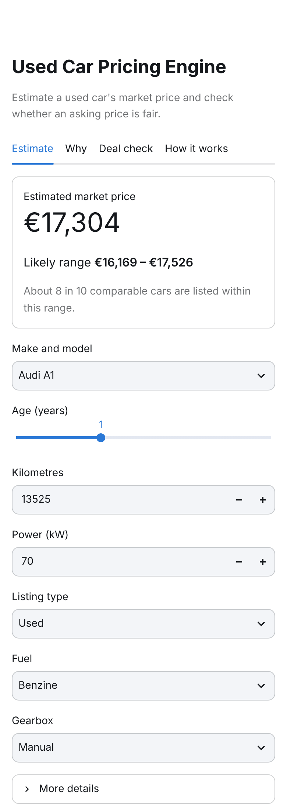

# Used Car Pricing Engine
**Live app:** https://used-car-pricing.streamlit.app/

Estimate a used car's listing price with a **price range**, see **why** the model gives that price, check whether an asking price is fair, and see how value changes with age and kilometres.

Built on AutoScout24 listings (Audi, Opel, Renault, aged 0–3 years) with scikit-learn pipelines, LightGBM and a Streamlit app.

> **Status: Version 2**: LightGBM with monotonic constraints, model-based price ranges (conformalized quantile regression), per-car SHAP explanations, depreciation chart.
> Version 1 (linear model) is kept as the baseline in every comparison. Planned: v3 (FastAPI, Docker, experiment tracking).

## Screenshots

| Estimate (phone) | Deal check (phone, dark mode) |
|---|---|
|  |  |

**Why this price** (desktop): top 5 reasons from SHAP values, and the depreciation chart generated by the model.


## Results

<!-- RESULTS:START -->
*Generated by `python -m src.report` from `models/metadata.json` (model trained 2026-11-18). Do not edit by hand.*

Data: 15,915 listings → 1,673 exact duplicates removed → 14,242 rows; split 11,393 train / 2,849 test (seed 42).

### Test set (used once, at the end)

| | Linear (v1) | LightGBM (v2) |
|---|---|---|
| Average % error (MAPE) | 7.6% | **5.1%** |
| Median % error | 5.7% | 3.4% |
| Average error (€) | €1,444 | €938 |
| R² | 0.905 | 0.955 |

LightGBM's average error is **33% lower** than the linear model's.

### Model comparison (5-fold cross-validation, training rows only)

| Model | CV MAPE | ± fold std | CV MAE | CV R² | Tuning time |
|---|---|---|---|---|---|
| HistGradientBoosting | 5.23% | 0.09 | €953 | 0.957 | 3.5 min |
| LightGBM | 5.28% | 0.10 | €965 | 0.955 | 1.1 min |
| Lasso | 7.83% | 0.25 | €1,460 | 0.907 | 0.1 min |
| Ridge | 7.83% | 0.24 | €1,460 | 0.908 | 0.1 min |

Selected: **LightGBM**. Rule (fixed before tuning):

```
Selection rule, fixed BEFORE tuning results were seen:

1. lowest cross-validated MAPE wins;
2. but if the best boosting model is within one fold-std of LightGBM, take
   LightGBM: it is faster and has exact per-car explanations built in
   (pred_contrib = TreeSHAP), so the app needs no extra explanation library.
```

### Errors by price band: before (linear) → after (LightGBM)

Bands are quintiles of training prices, grouped by **real** price. Bias = median of (predicted − real) / real.

| Real price | CV error, linear → LightGBM | Test error, linear → LightGBM | Test bias, linear → LightGBM |
|---|---|---|---|
| under €11,490 | 8.9% → 6.0% | 8.6% → 5.8% | +3.3% → +0.0% |
| €11,490–€15,500 | 7.5% → 5.2% | 7.3% → 5.1% | -0.4% → +0.4% |
| €15,500–€18,763 | 6.7% → 4.8% | 6.1% → 4.5% | +0.0% → -0.6% |
| €18,763–€22,990 | 6.4% → 4.3% | 6.3% → 4.2% | -0.1% → -0.5% |
| over €22,990 | 9.6% → 6.0% | 9.6% → 5.7% | -2.1% → -1.1% |

Most expensive cars (real price over €40,000, 35 test cars): median bias -6.3% → -3.5%; still under-estimated in 66% of cases (linear: 66%). **Improved, not solved.**


### Price ranges (target: 80% of real prices inside)

Raw 10%/90% quantile models alone (out-of-fold, training rows): 64.7% coverage, too narrow. After per-band conformal calibration, on the test set:

| Band | Coverage, by estimated price | Coverage, by real price | Average range width |
|---|---|---|---|
| **All cars** | 82.4% | 82.4% | 17.1% of estimate |
| under €11,490 | 80.9% | 78.8% | 16.2% of estimate |
| €11,490–€15,500 | 83.7% | 84.7% | 18.9% of estimate |
| €15,500–€18,763 | 82.1% | 83.4% | 14.6% of estimate |
| €18,763–€22,990 | 82.8% | 83.3% | 15.3% of estimate |
| over €22,990 | 82.3% | 81.6% | 20.1% of estimate |

The app groups by estimated price (the only price it knows), which is what the calibration targets.

High-price warning: shown above €21,900 (75th percentile of training prices), because ranges there are wider on average (18.8% vs 16.3%, out-of-fold).

### Data facts behind the cleaning decisions

- Price skew 1.27 → -0.04 after log1p.
- 875 km values are fractional; the most common: 1,647.36 km (841 rows), 18,035.13 km (33 rows), 41,748.58 km (1 row). These are filled-in averages, not odometer readings.
- All cars are 0–3 years old.

Model file: 5.7 MB (three LightGBM models). Library versions: scikit-learn 1.9.1, LightGBM 4.7.0.
<!-- RESULTS:END -->

## What the app does

Four tabs, no sidebar, so it works on a phone as well as a desktop. Light and dark themes are set in `.streamlit/config.toml`.

1. **Estimate:** enter the car (equipment is pre-filled with what most cars of that model have). The card shows the estimate and the car's own **likely price range**.
2. **Why:** the top 5 reasons behind the price in plain words (from SHAP values), and a **depreciation chart**: the model's price for this car at each age (0–3) across realistic km.
3. **Deal check:** enter an asking price. A bar shows where it sits against this car's range: *below range*, *fair* (inside) or *overpriced*.
4. **How it works:** model, test results and limits, read from the saved results.

Every uncertainty number on screen (range, warning, deal check) comes from the same per-car range, so the app never shows two different figures for the same thing.

## How it works

```
                 ┌─ point model:  LightGBM on log(price), price only falls as km/age rise ─► estimate
raw columns ─► tree preprocessing ─┼─ 10% quantile LightGBM ─┐
 (one pipeline each)             └─ 90% quantile LightGBM ─┴─► + conformal correction per price band ─► range
                                                         SHAP (pred_contrib) on the point model ─► top 5 reasons
```

**Tree preprocessing:** categories → integer codes (rare levels pooled, unseen → missing); imputed km repaired with the median km of the same listing type, learned on training rows; equipment lists → 0/1 flags for items on at least 1% of training cars.

### Key Version 2 decisions

- **Model choice by cross-validation only.** Linear, HistGradientBoosting and LightGBM were tuned and compared with 5-fold CV on training rows. The test set was used once, at the end. The tie-break rule was fixed before results were seen.
- **Monotonic constraints:** price may only fall as km or age rise. It costs almost no accuracy and keeps the depreciation chart sensible.
- **Conformalized quantile regression** for ranges: quantile models give each car its own width, and conformal calibration (per price band) makes about 80% of real prices land inside.
- **SHAP from LightGBM itself** (`pred_contrib=True`): exact per-car contributions, no extra library. On the log scale the effects multiply exactly to the estimate.
- **Depreciation chart from the model itself**, restricted to the km range real cars of each age have in the data, so it never extrapolates.

Version 1 decisions (deduplicate before splitting, log1p target, km repair, rare-level pooling, no dummy dropped for VIF) still apply; evidence is in `notebooks/01_eda.ipynb`.

## Project structure

```
used-car-pricing-engine/
├── .streamlit/config.toml   # app theme (light + dark)
├── data/                    # CSV goes here (not committed, see data/README.md)
├── models/
│   ├── pricing_model.joblib # PricingModel: point + 2 quantile pipelines + calibration
│   └── metadata.json        # all results, rules and app options (source of every number above)
├── notebooks/
│   ├── 01_eda.ipynb         # data checks behind the cleaning decisions
│   └── 02_modelling.ipynb   # v2: comparison, per-band errors, ranges, SHAP, depreciation
├── reports/figures/ and reports/screenshots/
├── src/
│   ├── config.py   cleaning.py   features.py   # settings, cleaning, preprocessing + pipelines
│   ├── train.py                                 # compare, select, calibrate, test once, save
│   ├── model.py                                 # PricingModel + conformal helpers
│   ├── explain.py                               # SHAP values -> plain-language reasons
│   ├── predict.py                               # what the app calls
│   ├── report.py                                # writes the README results section
│   └── evaluate.py   plot_style.py
├── tests/
├── streamlit_app.py
├── requirements.txt          # app + training (pinned)
├── requirements-dev.txt      # + pytest and notebook tools
└── packages.txt              # system library LightGBM needs on Streamlit Cloud
```

## Run it locally (Windows)

Requires **Python 3.12 or newer**.

- `requirements.txt`: what the app needs (also used by Streamlit Cloud).
- `requirements-dev.txt`: everything above **plus pytest and the notebook tools**. Install this one to run the tests.

```bat
cd "D:\DS Projects\used-car-pricing-engine"
python -m venv .venv
.venv\Scripts\activate
pip install -r requirements-dev.txt

python -m src.train          :: retrain (needs data\Car_Price_data.csv, about 5 minutes)
python -m src.report         :: refresh the README results from the saved metadata
python -m pytest             :: run tests
streamlit run streamlit_app.py   :: the app file is streamlit_app.py (there is no app.py)
```

## Deploy free on Streamlit Community Cloud

1. Push the repo to GitHub (the CSV stays out thanks to `.gitignore`; `models/` is committed).
2. On share.streamlit.io → *New app* → pick the repo, main file `streamlit_app.py`.
3. Under *Advanced settings*, choose **Python 3.12** (or newer). `packages.txt` installs `libgomp1`, which LightGBM needs on Linux.

## Limitations

- Only 7 models from 3 brands, ages 0–3 years. Anything else is outside the training data.
- Predicts the **listing** (asking) price, not the final sale price.
- The most expensive cars are still under-estimated more often than not (see results).
- Accidents, service history and condition are not in the data.

## Data

Course-provided (upGrad / IIIT Bangalore), originally AutoScout24 listings. No redistribution licence, so the CSV is not included. See `data/README.md`.
