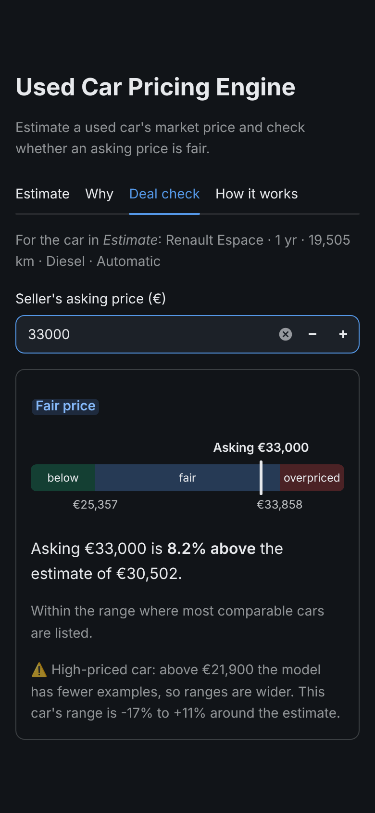
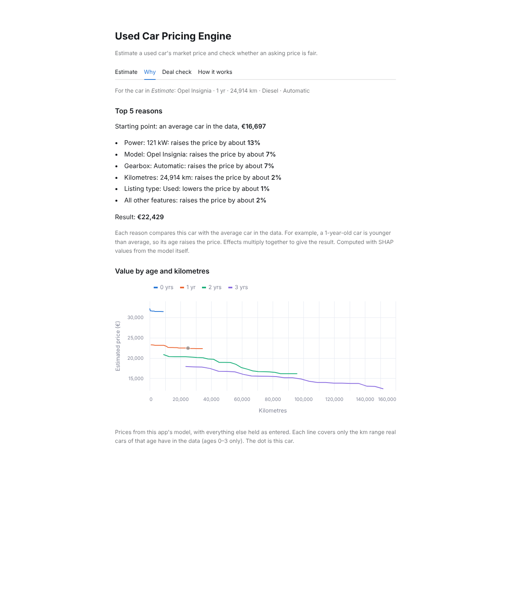
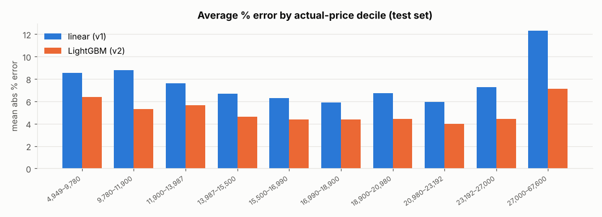
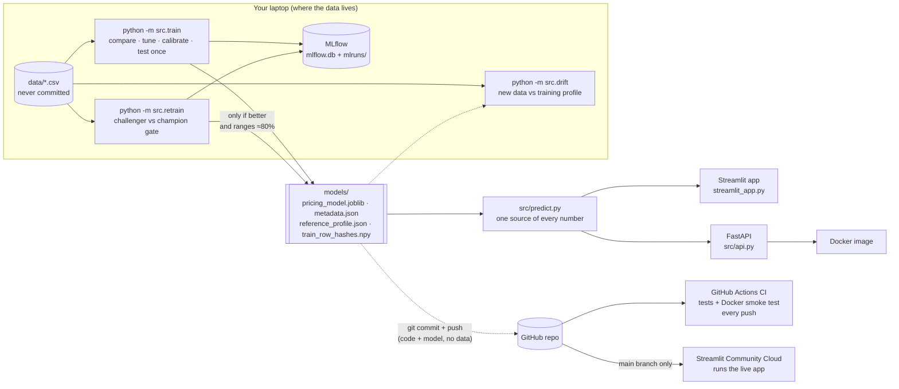

# Used Car Pricing Engine
**Live app:** https://used-car-pricing.streamlit.app/ · **Model card:** [MODEL_CARD.md](MODEL_CARD.md) (what the model is for, its data, accuracy and limits)

Estimate a used car's listing price with a **price range**, see **why** the model gives that price, check whether an asking price is fair, and see how value changes with age and kilometres.

Built on AutoScout24 listings (Audi, Opel, Renault, aged 0–3 years) with scikit-learn pipelines, LightGBM, a Streamlit app and a FastAPI service.

> **Status: Version 3 (production layer)**: FastAPI service, Docker image, MLflow experiment tracking, a retraining pipeline with a champion/challenger promotion gate, a data-drift check, and CI on GitHub Actions.
> Version 2 brought LightGBM, model-based price ranges and SHAP explanations; Version 1 (linear model) stays as the baseline in every comparison.

## Screenshots

| Estimate (phone) | Deal check (phone, dark mode) |
|---|---|
|  |  |

**Why this price** (desktop): top 5 reasons from SHAP values, and the depreciation chart generated by the model.



## Results

<!-- RESULTS:START -->
*Generated by `python -m src.report` from `models/metadata.json` (model trained 2026-11-18). Do not edit by hand.*

Data: 15,915 listings → 1,673 exact duplicates removed → 14,242 rows; split 11,393 train / 2,849 test (seed 42).

### Test set (used once, at the end)

| | Linear (v1) | LightGBM (v2) |
|---|---|---|
| Average % error (MAPE) | 7.6% | **5.1%** |
| Median % error | 5.7% | 3.4% |
| Average error (€) | €1,444 | €938 |
| R² | 0.905 | 0.955 |

LightGBM's average error is **33% lower** than the linear model's.

### Model comparison (5-fold cross-validation, training rows only)

| Model | CV MAPE | ± fold std | CV MAE | CV R² | Tuning time |
|---|---|---|---|---|---|
| HistGradientBoosting | 5.23% | 0.09 | €953 | 0.957 | 3.5 min |
| LightGBM | 5.28% | 0.10 | €965 | 0.955 | 1.1 min |
| Lasso | 7.83% | 0.25 | €1,460 | 0.907 | 0.1 min |
| Ridge | 7.83% | 0.24 | €1,460 | 0.908 | 0.1 min |

Selected: **LightGBM**. Rule (fixed before tuning):

```
Selection rule, fixed BEFORE tuning results were seen:

1. lowest cross-validated MAPE wins;
2. but if the best boosting model is within one fold-std of LightGBM, take
   LightGBM: it is faster and has exact per-car explanations built in
   (pred_contrib = TreeSHAP), so the app needs no extra explanation library.
```

### Errors by price band: before (linear) → after (LightGBM)

Bands are quintiles of training prices, grouped by **real** price. Bias = median of (predicted − real) / real.

| Real price | CV error, linear → LightGBM | Test error, linear → LightGBM | Test bias, linear → LightGBM |
|---|---|---|---|
| under €11,490 | 8.9% → 6.0% | 8.6% → 5.8% | +3.3% → +0.0% |
| €11,490–€15,500 | 7.5% → 5.2% | 7.3% → 5.1% | -0.4% → +0.4% |
| €15,500–€18,763 | 6.7% → 4.8% | 6.1% → 4.5% | +0.0% → -0.6% |
| €18,763–€22,990 | 6.4% → 4.3% | 6.3% → 4.2% | -0.1% → -0.5% |
| over €22,990 | 9.6% → 6.0% | 9.6% → 5.7% | -2.1% → -1.1% |

Most expensive cars (real price over €40,000, 35 test cars): median bias -6.3% → -3.5%; still under-estimated in 66% of cases (linear: 66%). **Improved, not solved.**



### Price ranges (target: 80% of real prices inside)

Raw 10%/90% quantile models alone (out-of-fold, training rows): 64.7% coverage, too narrow. After per-band conformal calibration, on the test set:

| Band | Coverage, by estimated price | Coverage, by real price | Average range width |
|---|---|---|---|
| **All cars** | 82.4% | 82.4% | 17.1% of estimate |
| under €11,490 | 80.9% | 78.8% | 16.2% of estimate |
| €11,490–€15,500 | 83.7% | 84.7% | 18.9% of estimate |
| €15,500–€18,763 | 82.1% | 83.4% | 14.6% of estimate |
| €18,763–€22,990 | 82.8% | 83.3% | 15.3% of estimate |
| over €22,990 | 82.3% | 81.6% | 20.1% of estimate |

The app groups by estimated price (the only price it knows), which is what the calibration targets.

High-price warning: shown above €21,900 (75th percentile of training prices), because ranges there are wider on average (18.8% vs 16.3%, out-of-fold).

### Data facts behind the cleaning decisions

- Price skew 1.27 → -0.04 after log1p.
- 875 km values are fractional; the most common: 1,647.36 km (841 rows), 18,035.13 km (33 rows), 41,748.58 km (1 row). These are filled-in averages, not odometer readings.
- All cars are 0–3 years old.

Model file: 5.7 MB (three LightGBM models). Library versions: scikit-learn 1.9.1, LightGBM 4.7.0.

Full details, intended use and limits: [MODEL_CARD.md](MODEL_CARD.md).
<!-- RESULTS:END -->

## What the app does

Four tabs, no sidebar, so it works on a phone as well as a desktop. Light and dark themes are set in `.streamlit/config.toml`.

1. **Estimate:** enter the car (equipment is pre-filled with what most cars of that model have). The card shows the estimate and the car's own **likely price range**.
2. **Why:** the top 5 reasons behind the price in plain words (from SHAP values), and a **depreciation chart**: the model's price for this car at each age (0–3) across realistic km.
3. **Deal check:** enter an asking price. A bar shows where it sits against this car's range: *below range*, *fair* (inside) or *overpriced*.
4. **How it works:** model, test results and limits, read from the saved results.

Every uncertainty number on screen (range, warning, deal check) comes from the same per-car range, so the app never shows two different figures for the same thing.

## Architecture



The app and the API both call `src/predict.py`, so they cannot give different answers (`tests/test_api.py` drives the real app and checks it shows exactly what the API returns).
Training, retraining and drift checks run **locally**, because the dataset is not in the repository; GitHub only runs the tests.

## How it works

```
                 ┌─ point model:  LightGBM on log(price), price only falls as km/age rise ─► estimate
raw columns ─► tree preprocessing ─┼─ 10% quantile LightGBM ─┐
 (one pipeline each)             └─ 90% quantile LightGBM ─┴─► + conformal correction per price band ─► range
                                                         SHAP (pred_contrib) on the point model ─► top 5 reasons
```

**Tree preprocessing:** categories → integer codes (rare levels pooled, unseen → missing); imputed km repaired with the median km of the same listing type, learned on training rows; equipment lists → 0/1 flags for items on at least 1% of training cars.

### Key Version 2 decisions

- **Model choice by cross-validation only.** Linear, HistGradientBoosting and LightGBM were tuned and compared with 5-fold CV on training rows. The test set was used once, at the end. The tie-break rule was fixed before results were seen.
- **Monotonic constraints:** price may only fall as km or age rise. It costs almost no accuracy and keeps the depreciation chart sensible.
- **Conformalized quantile regression** for ranges: quantile models give each car its own width, and conformal calibration (per price band) makes about 80% of real prices land inside.
- **SHAP from LightGBM itself** (`pred_contrib=True`): exact per-car contributions, no extra library. On the log scale the effects multiply exactly to the estimate.
- **Depreciation chart from the model itself**, restricted to the km range real cars of each age have in the data, so it never extrapolates.

Version 1 decisions (deduplicate before splitting, log1p target, km repair, rare-level pooling, no dummy dropped for VIF) still apply; evidence is in `notebooks/01_eda.ipynb`.

## Project structure

```
used-car-pricing-engine/
├── .github/workflows/ci.yml   # tests + Docker build/smoke test on every push
├── .streamlit/config.toml     # app theme (light + dark)
├── data/                      # CSV goes here (never committed, see data/README.md)
├── examples/predict_request.json
├── models/
│   ├── pricing_model.joblib   # PricingModel: point + 2 quantile pipelines + calibration
│   ├── metadata.json          # all results, rules and app options (source of every number above)
│   ├── reference_profile.json # training-data summary for the drift check (aggregates only)
│   ├── train_row_hashes.npy   # fingerprints of training rows (no raw data), for a fair promotion gate
│   └── promotion_log.jsonl    # every retraining decision and its reasons (created on first retrain)
├── notebooks/                 # 01_eda.ipynb, 02_modelling.ipynb
├── reports/figures/, reports/screenshots/
├── src/
│   ├── config.py  cleaning.py  features.py  model.py  explain.py  evaluate.py  plot_style.py
│   ├── train.py      # run_training(): compare, select, calibrate, test once, save, log to MLflow
│   ├── predict.py    # what the app AND the API call
│   ├── api.py        # FastAPI service
│   ├── tracking.py   # MLflow logging
│   ├── retrain.py    # retraining pipeline with the promotion gate
│   ├── drift.py      # drift check and report
│   └── report.py     # writes the README results section
├── tests/
├── Dockerfile  .dockerignore
├── streamlit_app.py
├── requirements.txt       # the Streamlit app (used by Streamlit Cloud)
├── requirements-api.txt   # the API (used by the Docker image)
├── requirements-dev.txt   # everything: app + API + MLflow + pytest + notebooks
├── packages.txt           # system library LightGBM needs on Streamlit Cloud
└── LICENSE                # MIT, code only
```

## Run it yourself

You need **Python 3.12 or newer** and **git**. You do **not** need the dataset to run the app, the API or the tests: the trained model is in `models/`.

**1. Download the project and install it**

Windows (Command Prompt):
```bat
git clone https://github.com/Kaushik075/used-car-pricing-engine.git
cd used-car-pricing-engine
python -m venv .venv
.venv\Scripts\activate
pip install -r requirements-dev.txt
```

Mac / Linux (Terminal):
```bash
git clone https://github.com/Kaushik075/used-car-pricing-engine.git
cd used-car-pricing-engine
python3 -m venv .venv
source .venv/bin/activate
pip install -r requirements-dev.txt
```
On a Mac, LightGBM also needs OpenMP: `brew install libomp`. On a minimal Linux, `sudo apt install libgomp1` if LightGBM fails to import.

The only differences between systems are the two activation lines above and setting an environment variable (MLflow row below). Every other command is the same everywhere; paths use `/`, which works on Windows too.

**2. Run it** (from the project folder, with the virtual environment active)

| What | Command | Needs the CSV? |
|---|---|---|
| Run the tests | `python -m pytest` | No (tests that need it are skipped) |
| Streamlit app | `streamlit run streamlit_app.py` | No |
| API (no Docker) | `uvicorn src.api:app --port 8000`, then open http://127.0.0.1:8000/docs | No |
| Full training run (about 5 min) | `python -m src.train` | **Yes** |
| Retrain with the promotion gate | `python -m src.retrain --data data/new_listings.csv` | **Yes** (plus your new data) |
| Drift check | `python -m src.drift --new data/new_listings.csv` | Your new data only |
| MLflow UI | Windows: `set MLFLOW_DISABLE_TELEMETRY=true` · Mac/Linux: `export MLFLOW_DISABLE_TELEMETRY=true`, then `mlflow ui --backend-store-uri sqlite:///mlflow.db` | No (shows runs you have made) |
| Refresh README results and model card | `python -m src.report` | No |

**3. Training needs your own copy of the data**

The dataset is not in this repository (no redistribution licence; see [Data](#data)). To train or retrain, get your own copy of `Car_Price_data.csv` and put it at `data/Car_Price_data.csv`. Every `*.csv` is git-ignored, so it can't be committed by accident.

## Version 3: the production layer

### API (FastAPI)

```bat
uvicorn src.api:app --port 8000
```
Open **http://127.0.0.1:8000/docs**: every endpoint has a "Try it out" button. Stop the server with Ctrl+C.

| Endpoint | What it returns |
|---|---|
| `GET /health` | status, which model is loaded, its test error |
| `GET /options` | allowed values for every field (models, categories, ranges, equipment) |
| `POST /predict` | estimate, likely range, high-price warning, deal verdict (if `asking_price` is given), top 5 reasons |

Only `make_model`, `age` and `km` are required; anything you leave out is filled with that model's typical values (as the app pre-fills its form) and listed in `filled_fields`.
Inputs are checked with Pydantic against the same limits as the app: unknown models or categories, values outside the training range (e.g. age 6) and misspelt field names all come back as a `422` that lists **every** problem in plain words.

From a second terminal window (Windows 10/11, Mac and Linux all include `curl`):
```bat
curl -X POST http://127.0.0.1:8000/predict -H "Content-Type: application/json" -d @examples/predict_request.json
```

### Docker (Docker Desktop on Windows or Mac; Docker Engine on Linux)

1. Start **Docker Desktop** and wait until it shows *Engine running*.
2. Build the image (first time takes a few minutes):
   ```bat
   docker build -t used-car-pricing-api .
   ```
3. Run it:
   ```bat
   docker run --rm -p 8000:8000 used-car-pricing-api
   ```
4. Open **http://localhost:8000/docs**. Stop it with Ctrl+C.

The image contains Python 3.12, the API's libraries, `src/` and the two model files only: no data, no notebooks, no training tools (see `.dockerignore`). It runs as a normal user and has a health check.
Docker is optional: the API runs the same way without it (previous section).

### Experiment tracking (MLflow)

Every run of `python -m src.train` or `python -m src.retrain` is logged to a local MLflow store (`mlflow.db` plus the `mlruns/` folder; both stay on your machine and are git-ignored):
parameters (chosen model and settings, data split, library versions), cross-validation results for every compared model, test results, range coverage per band, training time, the data file's name and SHA-256 fingerprint, and the model files themselves.

```bat
set MLFLOW_DISABLE_TELEMETRY=true
REM Mac/Linux: export MLFLOW_DISABLE_TELEMETRY=true
mlflow ui --backend-store-uri sqlite:///mlflow.db
```
Open **http://127.0.0.1:5000**, click **Model training** (top left; MLflow opens on its GenAI view), then the **used-car-pricing** experiment to see the runs. Tick two runs and click **Compare** to see what changed.
MLflow 3 sends anonymous usage telemetry by default; the project's code switches it off, and the `set` line does the same for the UI.

### Retraining with a promotion gate

```bat
python -m src.retrain --data data/new_listings.csv
```
1. A **challenger** is trained on the new data (the champion's tuned settings, about 2 minutes; add `--tune` for a full search) and saved in `models/candidates/<time>/`.
2. The evaluation set is the new data's test split **minus every row the champion was trained on** (checked against `train_row_hashes.npy`), so neither model has seen any evaluation row.
3. The challenger replaces the champion only if its average % error is at least **0.05 points lower** *and* its price ranges cover **75–85%** of real prices. With fewer than 500 unseen rows there is no fair comparison, so the champion stays.
4. The decision and its reasons are appended to `models/promotion_log.jsonl` and tagged on the challenger's MLflow run. On promotion, the old champion is archived in `models/archive/` and the README results are refreshed.

Add `--dry-run` to see the decision without replacing anything. A promoted model goes live only when you commit `models/` and merge to `main`.

### Drift check

```bat
python -m src.drift --new data/new_listings.csv
```
Compares the new CSV with the training data's saved profile, feature by feature, using the **Population Stability Index** (below 0.10 stable, 0.10–0.25 moderate, above 0.25 large), plus the median price and the share of rows the model has never seen (e.g. age above 3, an unknown model).
It prints a verdict and writes a short report to `reports/drift/`:
- **RETRAIN RECOMMENDED**: price level moved more than 5%, a large shift (PSI above 0.25), or more than 2% of rows outside what the model has seen
- **WATCH**: moderate shifts, or a feature's median moved more than 20%
- **OK**: nothing notable

### Continuous integration (GitHub Actions)

`.github/workflows/ci.yml` runs on every push and pull request (free for public repositories):
- **Tests** on Python 3.12. Tests that need the CSV skip cleanly because the data is not in the repository; the job also fails if any CSV file is ever committed.
- **Docker**: builds the image, starts it and checks `/health`, a real `/predict` request and a rejected bad request.

CI never trains or deploys. Retraining runs locally, where the data lives; publishing a new model is a commit to `main`.

## Deploy free on Streamlit Community Cloud

1. Push the repo to GitHub (the CSV stays out thanks to `.gitignore`; `models/` is committed).
2. On share.streamlit.io → *New app* → pick the repo, main file `streamlit_app.py`.
3. Under *Advanced settings*, choose **Python 3.12** (or newer). `packages.txt` installs `libgomp1`, which LightGBM needs on Linux.

## Limitations

- Only 7 models from 3 brands, ages 0–3 years. Anything else is outside the training data.
- Predicts the **listing** (asking) price, not the final sale price.
- The most expensive cars are still under-estimated more often than not (see results).
- Accidents, service history and condition are not in the data.

## Data

Course-provided (upGrad / IIIT Bangalore), originally AutoScout24 listings. No redistribution licence, so the CSV is not included. See `data/README.md`.

## License

The **code** is released under the [MIT License](LICENSE). The licence does not cover the dataset, which is not included in this repository.
